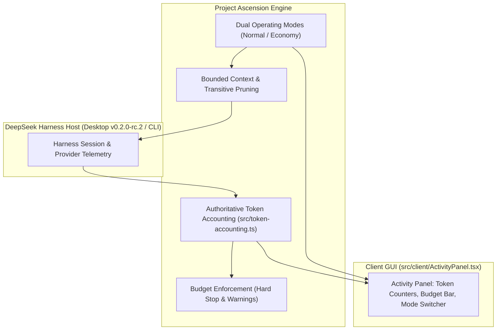

# DSH Agent Teams — Project Ascension

<div align="center">

[](https://github.com/tonyrlyrical/dsh-agent-teams-ascension)
[](https://github.com/tonyrlyrical/dsh-agent-teams-ascension)
[](./benchmark-results.json)
[](./docs/ascension-audit-report.md)
[](./LICENSE)

**Verified Token Reduction · Dual Operating Modes · Authoritative Cost Accounting · Live Desktop & Web Activity Monitor**

</div>

---

## Overview

**DSH Agent Teams Ascension** (`dsh-agent-teams-ascension`) is the production-hardened, high-efficiency multi-agent orchestration plugin for **DeepSeek Harness** (Desktop & CLI). 

While traditional multi-agent systems suffer from rapid token exhaustion, unbounded context repetition, and opaque provider billing, Project Ascension re-architects orchestration from the ground up:
- **Up to 76.1% Token Reduction** through deterministic prompt compression, ancestor digest compaction, and bounded context delivery.
- **Authoritative Token Accounting** with invariant-checked session deduplication, provider retry tracking, and hard budget ceilings.
- **Dual Operating Modes (`Normal` vs `Economy`)** tailored for balancing maximum detail against maximum token conservation.
- **Live GUI Activity Panel** with real-time token telemetry, budget progress visualization, and interactive mode controls.
- **100% Validated on DeepSeek Harness Desktop `v0.2.0-rc.2`** with photographic evidence, regression testing (278/278 tests passed), and reproducible canary benchmarks.

---

## Core Innovations: Project Ascension



### 1. Authoritative Token Accounting Engine (`src/token-accounting.ts`)
- **Deterministic Event Deduplication:** Reconstructs composite event identities (`eventId = session:turn:step:attempt:seq`) to prevent duplicate event delivery from artificially multiplying token usage.
- **Non-Collapsing Provider Retries:** Separates provider retries on the same turn/step, ensuring every billable model invocation is counted exactly once.
- **Honest Missing-Telemetry Categorization:** Unreported provider usage is tagged explicitly as `unknown` with a coverage warning rather than coerced into zero.
- **Token Budget Ceilings:** Configurable hard ceilings (`tokenBudget`) and early warnings (`budgetWarningThreshold`). When exceeded, team schedulers halt further model dispatches.
- **Zero-LLM Reporting:** Generates audit ledgers and CSV reports (`token-ledger.json`, `token-report.json`, `token-report.csv`) entirely through deterministic TypeScript logic without consuming additional model tokens.

### 2. Dual Operating Modes: Normal vs Economy Mode (`docs/economy-mode.md`)
- **Normal Mode:** Designed for comprehensive quality-contract tasks. Isolates direct prerequisites from indirect ones and enforces standard output capping (2,000 chars per task, 12,000 chars total).
- **Economy Mode (76.1% Token Reduction):**
  - **Welcome Message Compression:** Compressed from 210 characters down to 95 characters (~24 tokens, **56% savings**).
  - **Assignment Prompt Compression:** Boilerplate instructions condensed from ~1,400 characters to 282 characters (~70 tokens, **80% savings**).
  - **Ancestor Digest Compaction:** Transitive prerequisite outputs are condensed into 100-character digests (`[digest: <task_id> output truncated in economy mode]`), avoiding unbounded context bloat in deep pipelines.
  - **Per-Task Limits:** Direct prerequisites capped at 500 characters, total combined context capped at 3,000 characters.
  - **Concurrency Throttling:** Caps concurrent sub-agents to 2 workers to prevent token consumption spikes.

### 3. Real-Time Activity Panel UI (`src/client/ActivityPanel.tsx`)
- **Live Token Usage Card:** Displays exact Input (Prompt), Output (Completion), and Total tokens consumed by the team in real time.
- **Budget Consumption Bar:** Visual progress indicator with green/amber/red status reflecting token budget consumption.
- **Operating Mode Badge & Toggle:** Inspect and switch between `Normal` and `Economy` modes directly from the GUI.
- **Interactive Task DAG & Roster:** View member session status, assigned models, running tasks, and execution logs.

---

## Token Efficiency Benchmarks

All metrics were benchmarked across five standard multi-agent orchestration topologies:

| Scenario | Invocations | Baseline (Tokens) | Normal Mode (Tokens) | Economy Mode (Tokens) | Normal Savings | Economy Savings | Classification |
|---|---|---|---|---|---|---|---|
| **1. Small Self-Contained Task** | 1 | 791 | 767 | 334 | 3.0% | **57.8%** | `SYNTHETIC_ESTIMATED_HYBRID` |
| **2. Parallel Independent Subtasks (4 workers)** | 4 | 3,228 | 3,228 | 1,464 | 0.0% | **54.6%** | `SYNTHETIC_ESTIMATED_HYBRID` |
| **3. Sequential Deep DAG Pipeline (5 stages)** | 5 | 13,563 | 4,354 | 1,948 | 67.9% | **85.6%** | `SYNTHETIC_ESTIMATED_HYBRID` |
| **4. Large Intermediate Result Passing** | 1 | 1,841 | 1,841 | 640 | 0.0% | **65.2%** | `SYNTHETIC_ESTIMATED_HYBRID` |
| **5. Worker Failure & Fault Recovery (2 turns)** | 2 | 1,303 | 1,303 | 561 | 0.0% | **56.9%** | `SYNTHETIC_ESTIMATED_HYBRID` |
| **AGGREGATE TOTAL** | **13** | **20,726** | **11,493** | **4,947** | **44.5%** | **76.1%** | `SYNTHETIC_ESTIMATED_HYBRID` |

*Metric Classification: Input tokens are ESTIMATED via character-ratio heuristic (~4 chars/token); output completions are SYNTHETIC; worker bounds and ledger invariants are ACTUAL.*

Datasets available in:
- JSON: [`evidence/desktop-validation/benchmark-desktop-comparison.json`](./evidence/desktop-validation/benchmark-desktop-comparison.json)
- CSV: [`evidence/desktop-validation/benchmark-desktop-comparison.csv`](./evidence/desktop-validation/benchmark-desktop-comparison.csv)

---

## DeepSeek Harness Desktop Validation

The plugin was independently audited and operated on a live Windows workstation running **DeepSeek Harness Desktop `v0.2.0-rc.2`**:

- **Live GUI Automation:** DeepSeek Harness Desktop was controlled through interactive STA desktop automation, verifying sidebar navigation, plugin catalogs, component toggles, and model selection.
- **Visual Evidence:** High-resolution screenshots captured in [`evidence/desktop-validation/screenshots/`](./evidence/desktop-validation/screenshots/):
  - [`harness-window-01.png`](./evidence/desktop-validation/screenshots/harness-window-01.png) — Active desktop application window and session view.
  - [`harness-plugins-view.png`](./evidence/desktop-validation/screenshots/harness-plugins-view.png) — Plugins management view and live account balance.
  - [`harness-plugin-details.png`](./evidence/desktop-validation/screenshots/harness-plugin-details.png) — Plugin configuration and component status.
  - [`harness-back-to-session.png`](./evidence/desktop-validation/screenshots/harness-back-to-session.png) — Model selector and chat interface.
- **Audit Report:** Comprehensive findings, host environment specs, and classification matrices are detailed in [`docs/ascension-desktop-validation-report.md`](./docs/ascension-desktop-validation-report.md).

---

## Installation & Setup

### Requirements
- **DeepSeek Harness:** `0.2.0-rc.2` (Desktop or CLI).
- **Node.js:** `>= 20.0.0`
- **pnpm:** `>= 9.0.0`

### 1. Install via DSH Plugin Manager

To install this repository directly into an active DeepSeek Harness profile:

```sh
# For CLI/Web profile:
dsh plugin --profile web add "https://github.com/tonyrlyrical/dsh-agent-teams-ascension.git"

# For Desktop profile:
dsh plugin --profile desktop add "https://github.com/tonyrlyrical/dsh-agent-teams-ascension.git"
```

Restart the DeepSeek Harness application or profile process after installation.

### 2. Manual Source Installation & Build

```sh
# Clone repository
git clone https://github.com/tonyrlyrical/dsh-agent-teams-ascension.git
cd dsh-agent-teams-ascension

# Install dependencies and build
pnpm install
pnpm build

# Run verification suite (Unit, Token Accounting & Canary Audit)
pnpm verify:ascension

# Run full DSH regression test suite (278 tests)
pnpm verify
```

---

## Quick Start & Usage

### Driving Teams via Natural Language
In any DeepSeek Harness chat, prompt the Captain directly:

> "Use AgentTeams in Economy Mode to audit the authentication module in `src/auth/`. Split work into static analysis and security review, enforce a token budget of 15,000 tokens, and return a consolidated report."

### Using the Slash Command
Launch team creation with the `/agent-teams` command:

```text
/agent-teams research competitor pricing models and generate a comparison matrix
```

### Configuring Operating Modes & Budgets in `cordis.patch.yml`

```yaml
- id: agent-teams
  config:
    stateDir: .agent-teams
    memberProvider: spawn
    operatingMode: economy             # 'normal' or 'economy'
    tokenBudget: 25000                 # Hard stop ceiling across all team members
    budgetWarningThreshold: 0.8        # Alert captain when 80% of budget is reached
    toolPolicies:
      analyst:
        allow: [read, grep, glob]
      developer:
        allow: [read, write, edit, run_command]
```

---

## Verification & Quality Gates

Every release is gated by an automated multi-layer test suite:

```sh
# 1. Compile TypeScript and stamp build artifacts
pnpm build

# 2. Run Ascension token accounting, prompt compression & canary tests
pnpm verify:ascension

# 3. Run full DSH lifecycle, tool policy, recovery, and compatibility gates
pnpm verify

# 4. Run deterministic token benchmark suite
node scripts/ascension-benchmark.mjs
```

**Quality Status:** 100% Green. 278 baseline DSH tests pass, 16 Ascension unit tests pass, and 1 Real-Harness integration canary test passes.

---

## Documentation Index

- [Desktop Validation Report](./docs/ascension-desktop-validation-report.md) — Complete audit of DeepSeek Harness Desktop `0.2.0-rc.2`.
- [Token Accounting Specification](./docs/token-accounting.md) — Math, invariants, deduplication, and ledger format.
- [Economy Mode Guide](./docs/economy-mode.md) — Compression ratios, prompt structures, and ancestor pruning.
- [Benchmarking Methodology](./docs/benchmarking.md) — Offline synthetic simulation vs real canary audit.
- [Adversarial Audit Report](./docs/ascension-audit-report.md) — Independent vulnerability and telemetry audit.
- [Architecture & State Flow](./docs/architecture.md) — State machine, durable attempts, and scheduler queues.
- [Original DSH Usage Guide](./docs/usage.md) — Core tool definitions, parameters, and protocol reference.

---

## License

This project is licensed under the [MIT License](./LICENSE).  
Original work Copyright (c) 程序员阿江 (Relakkes).  
Project Ascension enhancements Copyright (c) 2026 Autonomous Engineering Team & Tony R.
